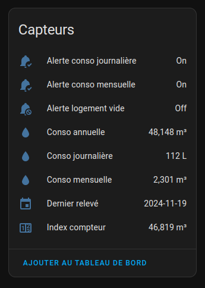
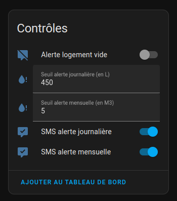
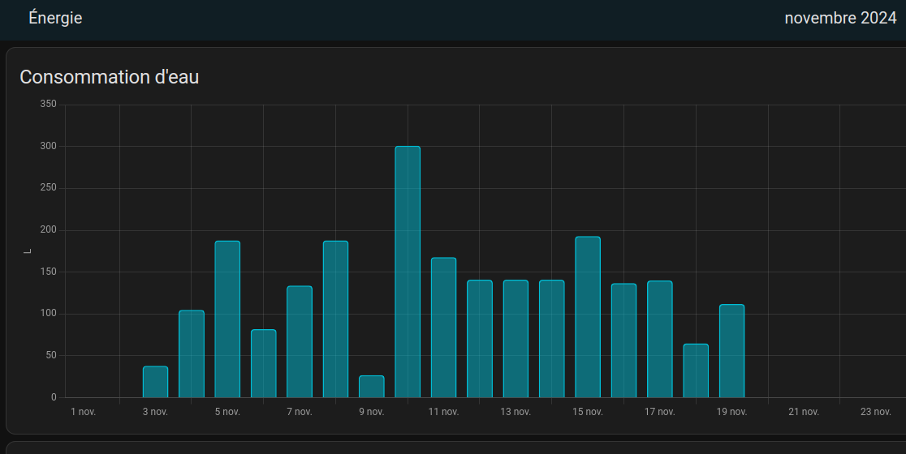
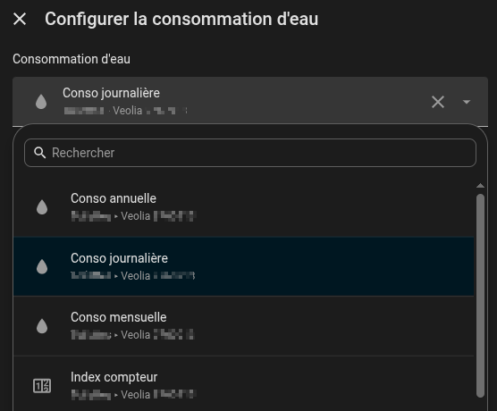
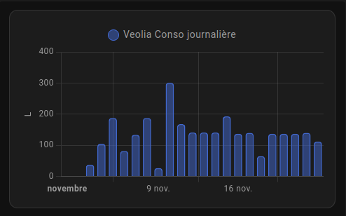
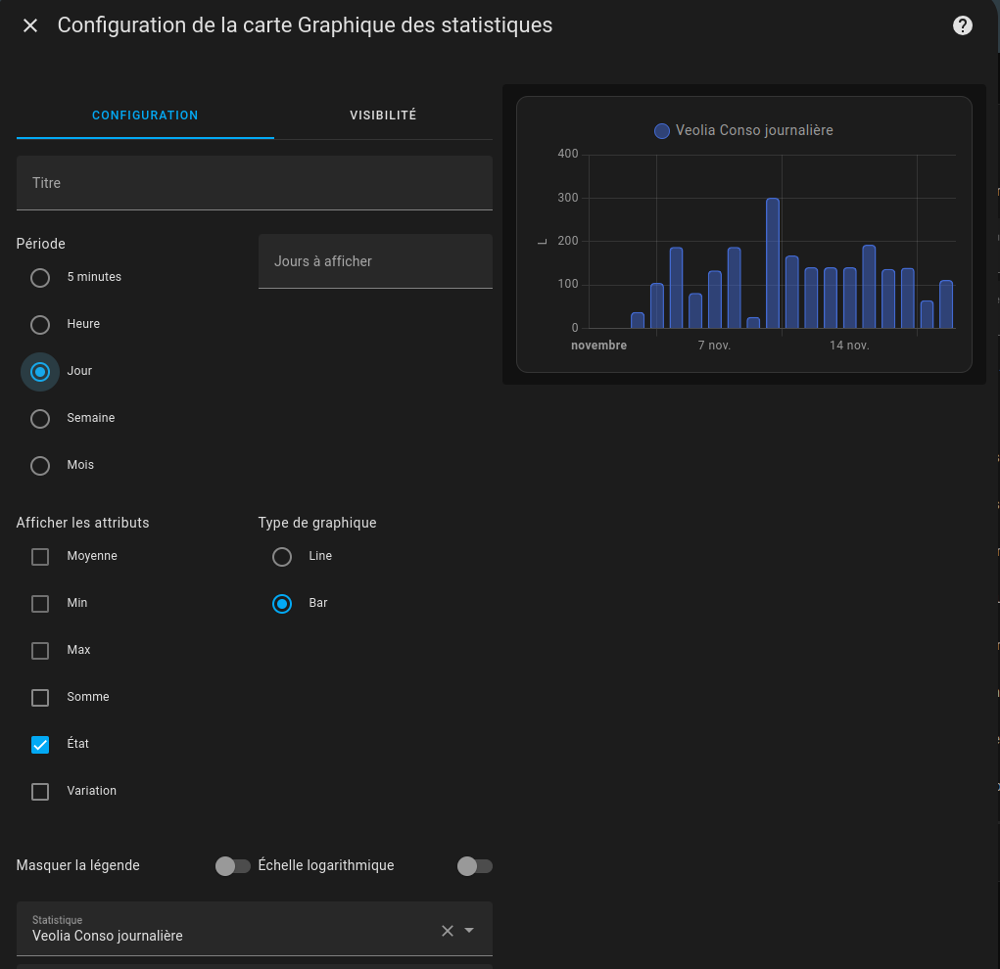

<a href=""></a>

[![GitHub Release][releases-shield]][releases]
[](https://hacs.xyz/docs/faq/custom_repositories)

> [!NOTE]
>
> **Version dérivée** de l'intégration [homeassistant_veolia](https://github.com/Jezza34000/homeassistant_veolia) de @Jezza34000 (licence MIT), avec des corrections :
>
> - nouveau capteur **« Conso dernier jour »** : consommation du dernier jour publié par Veolia, avec sa date (le capteur « Conso journalière » ne donne que le jour même, que Veolia ne publie jamais : il reste vide) ;
> - les **statistiques** (graphiques, tableau de bord Énergie) sont mises à jour à chaque relève, et plus seulement au démarrage de Home Assistant ;
> - compatibilité Python 3.13.
>
> Le domaine reste `veolia` : cette version remplace l'originale (ne pas installer les deux).

> ### Portails compatibles : voir [PORTALS.md](https://github.com/Jezza34000/homeassistant_veolia/blob/main/PORTALS.md)
>
> ### N'est PAS compatible avec : https://service.eau.veolia.fr & https://espace-client.vedif.eau.veolia.fr

---


## Informations disponibles

**Cette intégration configurera les plateformes suivantes.**

| Plateforme      | Description                                         |
| --------------- | --------------------------------------------------- |
| `sensor`        | Affiche les informations de l'API Veolia            |
| `switch`        | Switch d'activation/désactivation des alertes conso |
| `text`          | Saisie des valeurs de réglages des alertes          |
| `binary_sensor` | Affiche l'états des alertes conso                   |

### Données disponibles

- Consommation d'eau (journalière, mensuelle)
- Consommation du dernier jour publié par Veolia (`sensor.veolia_xxx_conso_dernier_jour`), avec sa date en attribut
- Index de consommation d'eau
- Seuils d'alertes de consommation d'eau
- Etat des alertes de consommation d'eau
- Date de la dernière relève de consommation d'eau

> #### **Note :** Les données de l'intégration sont mises à jour toutes les 12h.

### Capteurs :

<a href=""></a>

### Contrôles :

<a href=""></a>

### Configuration des alertes

L'intégration Veolia permet de configurer des alertes de consommation d'eau pour surveiller votre utilisation
quotidienne et mensuelle, et même pour détecter une fuite si vous n'êtes pas chez vous.

Les alertes sont activées ou désactivées, en renseignant les champs seuils d'alertes (0 = désactivé, >0 = activé)

Il existe 3 types d'alertes :

- Alerte journalière
  - L'alerte journalière est une alerte qui se déclenche si votre consommation d'eau quotidienne dépasse un certain seuil **cette valeur est en litre, le minimum est de 100 litres.**
- Alerte mensuelle
  - L'alerte mensuelle est une alerte qui se déclenche si votre consommation d'eau mensuelle dépasse un certain seuil **cette valeur est en metre cubes, le minimum est de 1m3**.
- Alerte logement "vide"
  - L'alerte logement vide est une alerte qui se déclenche si une consommation d'eau est détectée alors que vous n'êtes pas chez vous.

Informations supplémentaires :

> Les notifications d'alerte sont envoyées par Veolia directement par email et par SMS (aux coordonnées de contact renseigné dans votre compte Veolia).

> Il n'est pas possible de désactiver les notifications d'alerte par email, mais vous pouvez choisir d'activer ou pas les notifications par SMS, uniquement si un seuil est renseigné.

### Visualisation des données de consommation

L'intégration Veolia permet de visualiser les données de consommation d'eau en natif dans Home Assistant. Elle re-télécharge l'historique du mois en cours depuis Véolia et met à jour la base de données Home Assistant.

> Pour visualiser les informations à la bonne date, il est nécéssaire d'utiliser le sensor de consommation journalière (l'utilisation du sensor index compteur générera un décalage dans les dates)

#### 1. Ajout au dashboard energie de Home Assistant

<a href=""></a>

Pour ajouter la consommation d'eau au dashboard energie de Home Assistant, allez `Energie` -> crayon en haut à droite -> `Eau` -> `Ajouter une consommation d'eau` -> Dans le champ `Consommation d'eau` choissisez `sensor.veolia_xxx_conso_journaliere`

<a href=""></a>

#### 2. Ajout d'une carte de consommation d'eau journalière

> [!WARNING]
>
> Pourquoi le sensor `veolia_xxx_conso_journaliere` reste à 0 ? Je n'arrive pas à avoir ma consommation du jour ?
>
> C'est une contrainte technique de Veolia, PAS UN BUG !
>
> Veolia traite et publie les données de consommation avec un délai de minimum 24 hrs, parfois beacoup plus en fonction de la fréquence de collecte de la zone.
> L'intégration ne peut retourner que ce que l'API Veolia expose, elle ne peut pas récupérer des données que Veolia n'a pas encore publiées...
>
> Le seul usage de ce sensor est l'usage avec une carte graphique comme décrit ci-dessous.
>
> **Pour afficher la consommation d'une journée sur une carte, utilisez `sensor.veolia_xxx_conso_dernier_jour`** : il donne toujours le dernier jour publié par Veolia (J-1 ou plus), avec sa date dans l'attribut `date`.

<a href=""></a>

Pour ajouter la carte de consommation d'eau journalière, sur votre dashboard, cliquez sur `Ajouter une carte` puis selectionner `Graphique des statistiques` et choissisez l'entité `sensor.veolia_xxx_conso_journaliere`, configurer la carte comme l'exemple ci-dessous :

<a href=""></a>

> #### **Note :** La carte Graphique des statistiques ne fonctionnera qu'avec le sensor `sensor.veolia_xxx_conso_journaliere`

## Vérifier l'éligibilité de votre commune

Avant d'installer l'intégration, vous pouvez vérifier si votre commune est prise en charge en interrogeant l'API Veolia depuis votre navigateur ou avec `curl` :

```
https://prd-ael-sirius-refcommunes.istefr.fr/communes-nationales?q=VOTRE_CODE_POSTAL
```

Dans le résultat JSON, cherchez votre commune et examinez le champ `type_commune` :

| Valeur `type_commune`         | Éligibilité                                  |
| ----------------------------- | -------------------------------------------- |
| `NON_REDIRIGE`                | ✅ Compatible — portail `eau.veolia.fr`      |
| `REDIRIGE` (hostname connu)   | ✅ Compatible — portail alternatif supporté  |
| `REDIRIGE` (hostname inconnu) | ❌ Non supporté — portail non encore intégré |
| `NON_DESSERVIE`               | ❌ Veolia ne dessert pas cette commune       |

# Portails Veolia supportés (04/2026)

| Hostname                          | Description               |
| --------------------------------- | ------------------------- |
| `eau.veolia.fr`                   | Veolia France (national)  |
| `eaudetm.monespace.eau.veolia.fr` | Eau de Toulouse Métropole |

Votre portail n'est pas géré? Voir [CONTRIBUTING.md](https://github.com/Jezza34000/homeassistant_veolia/blob/main/CONTRIBUTING.md#adding-a-portal)

## Installation

### Via [HACS](https://hacs.xyz/) (recommandé)

**Cliquez ici:**

[](https://my.home-assistant.io/redirect/hacs_repository/?owner=frederic76430&repository=homeassistant_veolia&category=integration)

**ou suivez ces étapes:**

1. Ouvrez HACS (Home Assistant Community Store)
2. Cliquez sur les trois points en haut à droite
3. Cliquez sur `Dépôts personnalisées`
4. Dans le champ `Dépôt` entrez https://github.com/frederic76430/homeassistant_veolia/
5. Dans le champ `Type` sélectionnez `Intégration`
6. Cliquez sur `Ajouter`
7. Recherchez `Veolia` dans la liste des intégrations
8. Installez l'intégration
9. Redémarrez Home Assistant
10. Ouvrez paramètres -> intégrations -> ajouter une intégration -> recherchez `Veolia`
11. Suivez les instructions pour configurer l'intégration

### Manuellement

1. Copiez le dossier `custom_components/veolia` dans le dossier `custom_components` de votre configuration Home Assistant.
2. Redémarrez Home Assistant
3. Ouvrez paramètres -> intégrations -> ajouter une intégration -> recherchez `Veolia`
4. Suivez les instructions pour configurer l'intégration

## Bug et demande de fonctionnalités

- [Cliquez-ici](https://github.com/frederic76430/homeassistant_veolia/issues)

## Historique des versions

### 2.1.1
- Nouveau capteur « Conso dernier jour » (dernier jour publié, avec sa date)
- Statistiques mises à jour à chaque relève (cumul continu, sans valeur négative dans le tableau de bord Énergie)
- Compatibilité Python 3.13

## API Veolia

Cette intégration utilise le client API Veolia de @Jezza34000 disponible ici : [veolia-api](https://github.com/Jezza34000/veolia-api).

## Crédits

Intégration d'origine : [homeassistant_veolia](https://github.com/Jezza34000/homeassistant_veolia) par @Jezza34000 (licence MIT). Merci à lui pour son travail.


Le modèle de code de cette intégration à principalement été tiré du blueprint de @Ludeeus. Merci à lui pour son travail.

[![GitHub Activity][commits-shield]][commits]
[![License][license-shield]](LICENSE)
![Project Maintenance][maintenance-shield]

---

<!---->

[hacsbadge]: https://img.shields.io/badge/HACS-Custom-orange.svg?style=for-the-badge
[hacs]: https://hacs.xyz
[releases-shield]: https://img.shields.io/github/v/release/frederic76430/homeassistant_veolia.svg?style=for-the-badge
[releases]: https://github.com/frederic76430/homeassistant_veolia/releases
[commits-shield]: https://img.shields.io/github/commit-activity/y/ludeeus/integration_blueprint.svg?style=for-the-badge
[commits]: https://github.com/frederic76430/homeassistant_veolia/commits/main
[license-shield]: https://img.shields.io/github/license/ludeeus/integration_blueprint.svg?style=for-the-badge
[maintenance-shield]: https://img.shields.io/badge/maintainer-%20%40frederic76430-blue.svg?style=for-the-badge
[sensorsimg]: images/entities.png
